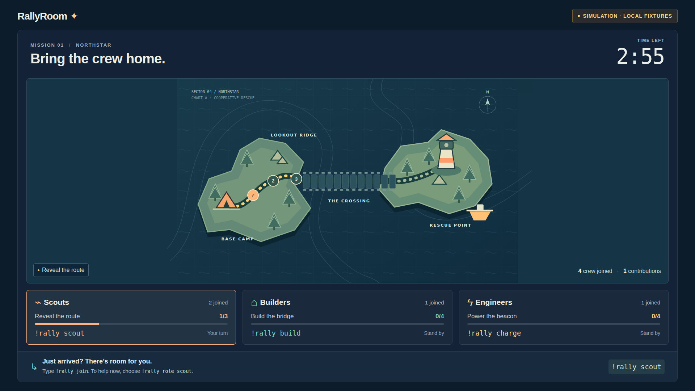
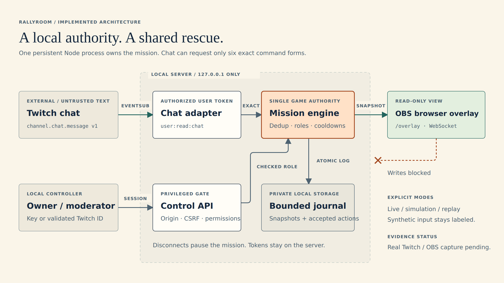

# RallyRoom

One chat. One mission. Viewers cooperate on a three-minute rescue: scouts reveal a route, builders bridge the crossing, and engineers power the beacon. A local dashboard controls the mission; OBS displays a read-only browser overlay.

**Working local product.** The deterministic engine, simulation, dashboard, overlay, persistence and Twitch OAuth/EventSub implementation are present. Automated tests cover the local and mocked-provider paths. Genuine Twitch/OBS validation and the final demonstration video remain pending access to a consenting channel and graphical workstation.



This screenshot shows generated local fixtures, not a live Twitch session.

## Run locally

Use Node 22.12+ on the Node 22 LTS line, or Node 24 LTS. The build used Node 22.23.3 and npm 10.9.9; `.nvmrc` pins that verified version.

```sh
npm ci
npm run dev
```

Open **http://localhost:3000**. The server defaults to visibly labeled simulation mode and binds only to loopback. Read `.data/control-key` privately (`cat .data/control-key` on your workstation), then enter it in **Unlock controls**. Do not share or record the key.

1. Click **Add test crew**.
2. Click **Start mission**.
3. Click **Run automatic fixtures**, or choose a participant/command and **Send fixture**. Automatic fixtures respect real five-second cooldowns.
4. Try **Pause mission**, **Resume mission**, and a **Late joiner fixture**. Complete the route, bridge and beacon to see the rescue and team recap.
5. Open **http://localhost:3000/overlay**. This view has no controls and its WebSocket rejects client messages.

Production assets and server:

```sh
npm run build
npm start
```

The live mode also runs locally; production build does not deploy anything. A generated fixture replay is available with `RALLY_MODE=replay npm start` on Linux/macOS, or set `RALLY_MODE=replay` in your local `.env`. The overlay says **REPLAY · GENERATED FIXTURE**. Replay runs on the recorded virtual timestamps, advancing one fixture input per second; it is not a live recording.

## Connect Twitch and OBS

Follow [TWITCH_SETUP.md](docs/TWITCH_SETUP.md) for app registration, exact scope/identity checks, credentials, controller delegation, token lifecycle and live verification. Use a consenting broadcaster's user token with **`user:read:chat`**. There is no bot chat sending or runtime AI.

On the same workstation as the server, add an OBS **Browser** source:

| Setting | Value |
| --- | --- |
| URL | `http://localhost:3000/overlay` |
| Width / height | `1920` / `1080` |
| Compact layout | `http://localhost:3000/overlay?compact=1`, `1280` / `720` |
| Credentials in source URL | None |

OBS was not available on the build host. Browser screenshots verify page rendering, not actual OBS capture or streamed-frame readability. Do not expose the local server through a public tunnel; remote control hosting is outside this MVP.

## Chat commands

| Exact command | Effect |
| --- | --- |
| `!rally join` | Join the least-filled role, including mid-round |
| `!rally role scout` | Choose scout; replace with `builder` or `engineer` to switch |
| `!rally scout` | Scouts reveal three route markers |
| `!rally build` | Builders add four bridge contributions after the route |
| `!rally charge` | Engineers add four beacon contributions after the bridge |
| `!rally help` | Current guidance appears on the shared overlay; no bot reply |

Commands are case-sensitive ASCII with exact spaces. Choose your role explicitly after joining if you want to perform the current objective; the overlay omits participant names. One contribution per account per five seconds; role switches have a separate five-second cooldown and do not reset action cooldowns. Targets stay at 3/4/4 for all group sizes, with the starting participant count recorded. These are initial design values, not user-tested balance. One or two people can switch roles to finish. Multiple accounts can bypass per-account limits; this is not a unique-person fairness system.

## Checks and evidence

```sh
npm test
npm run typecheck
npm run simulate
npm run evaluate
npx playwright install chromium   # once, if the browser is absent
npm run test:e2e
npm run smoke                    # with the local server already running
```

`simulate` uses virtual time and writes a labeled generated replay under `.data/`. `evaluate` records an engine-only synthetic microbenchmark at 10/100/500 fixture actors, including hardware, sample counts and latency. It excludes network, persistence and Twitch performance. Browser tests use port 3100 and isolated `.data/e2e` state. See [evaluation](docs/EVALUATION.md) and [evidence provenance](docs/evidence/README.md).

## Architecture and data



[Editable HTML](docs/architecture/rallyroom-architecture.html) · [SVG](docs/architecture/rallyroom-architecture.svg)

| Code | Responsibility |
| --- | --- |
| `packages/game/src/` | Pure reducer, exact grammar, balance and monotonic clock adapter |
| `apps/server/src/twitch/` | Server-only OAuth, validation/refresh and EventSub connection |
| `apps/server/src/auth/`, `server.ts` | Sessions, origin/CSRF checks, permissioned controls and view-only sockets |
| `apps/server/src/rooms/`, `storage/` | Single game authority, pseudonyms, bounded journal and crash recovery |
| `apps/web/src/` | React dashboard, onboarding/field guide and SVG rescue overlay |
| `fixtures/`, `tests/`, `scripts/` | Generated scenarios, checks, simulation and measurement |
| `videos/` | Isolated Videowright project and genuine-footage assembly preparation |

Chat text is untrusted data. Only exact parsed commands enter the reducer; no chat HTML, shell calls, external URLs or runtime model interpretation. The server verifies broadcaster/subscription identity, provider time, round, participant, role, phase, cooldown and both delivery/chat IDs. Duplicate retention is ten minutes or 12,000 IDs, bounded; each room admits at most 500 accounts. The transport rejects stale messages older than 30 seconds and messages predating the lobby/start boundary.

The private `.data` directory contains owner key, pseudonym salt, Twitch tokens and separate room journals for simulation, replay and each live channel. Every journal transaction contains the state and up to 2,000 accepted event records; files rotate at 16 MiB. Default retention is seven days (`RETENTION_DAYS=1..30`), pruned on activity/startup. Records contain HMAC pseudonyms, command enums, sequence, timestamps and round IDs, not raw chat or display names. **Stream setup → Clear mission history** clears the current room's journal. It does not clear other modes or revoke Twitch credentials. Backups are your responsibility.

A restarted running mission recovers paused. Overlay reconnect gets a full snapshot and checks sequence. Twitch gaps freeze the mission and remain visible; missed provider events cannot be recovered. One local process owns the state. Multi-process scaling, public hosting and replaying saved live history are not included; the current replay viewer demonstrates generated fixtures.

## Build and media record

Main Codex session: `01a16f7e-4c97-70f1-81b9-46b2c4e2e308`, read from the supported `thread.sessionId` interface. [Build log](docs/CODEX_BUILD_LOG.md) · [progress](docs/PROGRESS.md) · [tool inventory](docs/TOOL_INVENTORY.md).

The [demo runbook](docs/DEMO.md) lists the remaining genuine captures and the ≤3-minute edit. No upload, external post, public deployment or challenge submission has occurred. [Project story](docs/DEVPOST_PROJECT_STORY.md), [Built With](docs/BUILT_WITH.md), and [asset/dependency notices](docs/ASSETS_AND_NOTICES.md) reflect current evidence.
